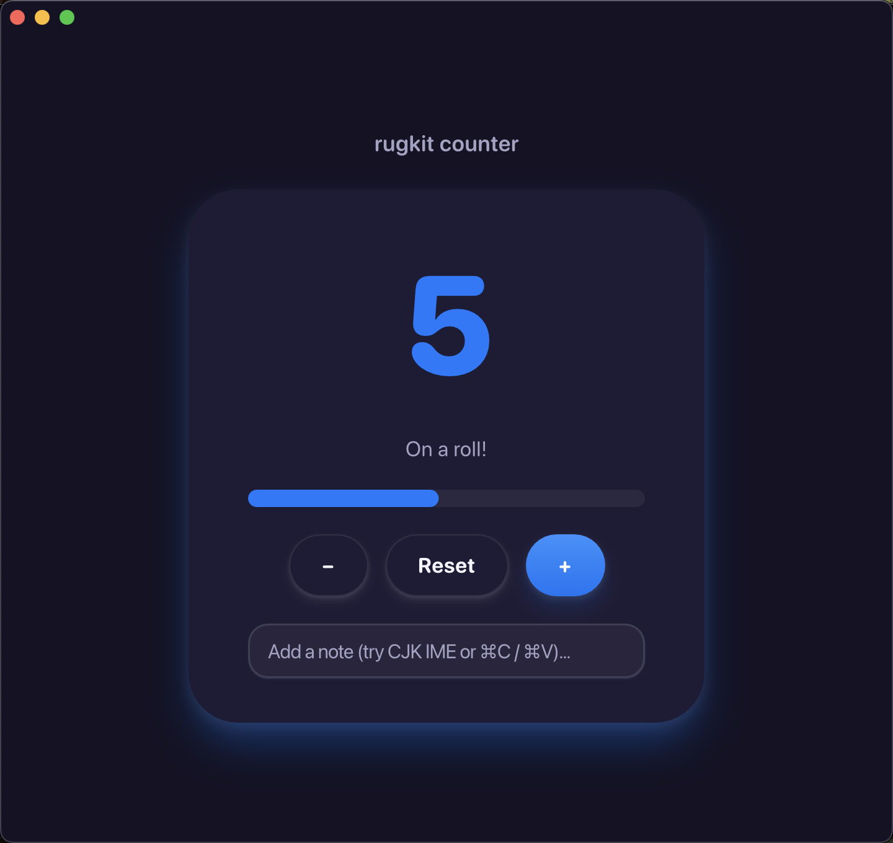

# rugkit

**Rugkit - The one framework that cares about visuals.**

rugkit is a Rust GUI framework built around visual polish and motion: a bold, playful design language, implicit spring animations, soft layered shadows and crisp text out of the box.

> **Status: early development, M2 (platform plumbing).** Nothing is published yet. v1 targets macOS first and keeps the core portable. See [PLAN.md](PLAN.md) for decisions, scope and milestones.



## What works today
- A window with a GPU-rendered frame loop (winit + wgpu/Metal + vello) and transparent macOS titlebar with draggable regions
- `Painter`: rounded rectangles, circles, strokes, linear gradients, gaussian soft shadows, rounded clipping
- Text shaped by parley: SF Pro Rounded for UI text and SF Pro for dense text, both loaded from macOS (never bundled), with variable font weights
- Live `FrameStats` (fps, CPU time, GPU time, worst frame)
- **Signals:** Copy `signal`, `memo` and `effect` handles with owners and batching. Updates are glitch-free and fine-grained, with no diffing, and automatically wake an idle window via `WakeHandle`.
- **Views as builder chains:** `text`, `button`, `text_input`, `row` and `column`, built once into a retained tree. Every setter takes a value or a closure that reads signals.
- **Flexbox layout** via taffy, hidden behind rugkit's own types
- **Implicit springs:** size, position, colour, elevation, scale, lift and focus rings all animate, and interrupting an animation keeps its velocity. The macOS "Reduce motion" setting is respected.
- **System appearance:** follows macOS Light/Dark mode and system accent colour, animated on change.
- **Platform integration:** Tab / Shift+Tab focus traversal with animated focus rings, `TextInput` with CJK IME composition & clipboard shortcuts (`⌘C`/`⌘X`/`⌘V`/`⌘A`), VoiceOver accessibility via AccessKit, native macOS menu bars, and a headless `Harness` test API.
- **On-demand frames:** an idle window draws nothing

## Try it

Requires macOS and Rust 1.98 or newer.

```bash
cargo run --release --example counter
```

```bash
cargo run --release --example m0_pixels
```

```rust
use rugkit::prelude::*;

fn main() -> Result<(), rugkit::Error> {
    rugkit::launch(WindowOptions::default(), || {
        let count = signal(0);
        column((
            text(move || count.get().to_string()).size(64.0).weight(FontWeight::BLACK),
            button("Add one").on_click(move || count.update(|c| *c += 1)),
        ))
        .gap(16.0)
    })
}
```

## Roadmap
M0 pixels → M1 signals, layout and springs → M2 platform integration (focus, IME, accessibility) → M3 widgets, theming, inspector → M4 Table and Canvas → M5 hot-reload → M6 flagship app and 0.1. Details are in [PLAN.md](PLAN.md).

## Contributing
Read [AGENTS.md](AGENTS.md) first. It covers workspace layout, commands and the rule that docs are updated in the same change as the code.

## License
Licensed under either of [Apache License, Version 2.0](LICENSE-APACHE) or [MIT license](LICENSE-MIT), at your option.
