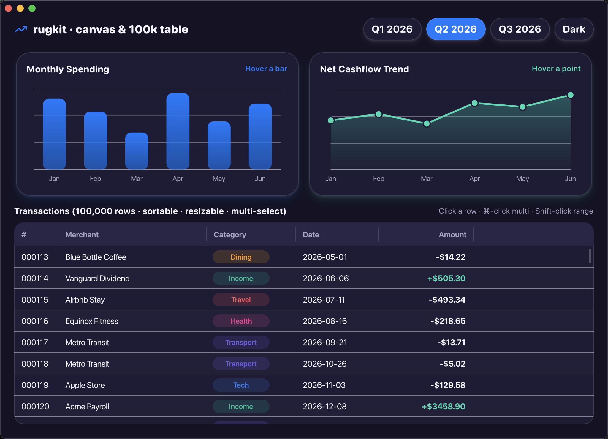

# rugkit

**Rugkit - The one framework that cares about visuals.**

rugkit is a Rust GUI framework built around visual polish and motion: a bold, playful design language, implicit spring animations, soft layered shadows and crisp text out of the box.

> **Status: early development, M4 (Table + Canvas).** Nothing is published yet. v1 targets macOS first and keeps the core portable. See [PLAN.md](PLAN.md) for decisions, scope and milestones.



## What works today
- A window (or multiple windows via `run_windows` sharing reactive signals) with a GPU-rendered frame loop (winit + wgpu/Metal + vello) and transparent macOS titlebar with draggable regions
- `Painter`: rounded rectangles, circles, vector `Path`s (with SVG `d` parsing), strokes, linear gradients, gaussian soft shadows, rounded clipping, opacity layers, RGBA8 `ImageData`, and offscreen GPU rendering (`OffscreenRenderer`)
- Text shaped by parley: SF Pro Rounded for UI text and SF Pro for dense text, both loaded from macOS (never bundled), with variable font weights
- Live `FrameStats` (fps, CPU time, GPU time, worst frame)
- **Signals:** Copy `signal`, `memo` and `effect` handles with owners and batching. Updates are glitch-free and fine-grained, with no diffing, and automatically wake an idle window via `WakeHandle`.
- **Core widget set:** `text`, `button`, `text_input` (single-line & multiline), `checkbox`, `toggle`, `slider`, `radio`, `select`, `tabs`, `scroll`, `virtual_list` (100k+ rows), `table` (100k+ virtualised rows, sticky header, sort, column resize, single & multi-row selection, custom cell renderers), `canvas` (reactive `Painter` surface with automatic signal tracking and `HitRegions` hit-testing), `image`, `icon` (bundled Lucide set behind default-on `icons` feature), `modal`, `popover`, `tooltip`, `row`, `column`, `grid`, `zstack`.
- **Layout:** Flexbox & CSS Grid via taffy, hidden behind rugkit's own types, plus RTL layout mirroring (`direction_scope(Direction::Rtl, ...)`).
- **Theming & motion:** Typed design tokens (`Theme`, `Radii`, `Spacing`, `TypeScale`) with reactive macOS Light/Dark + accent tracking and subtree overrides (`theme_scope`). Implicit springs animate size, position, colour, elevation, scale, lift, opacity and focus rings while respecting macOS "Reduce motion".
- **Platform integration:** Tab / Shift+Tab focus traversal with animated focus rings, CJK IME composition & clipboard shortcuts (`⌘C`/`⌘X`/`⌘V`/`⌘A`), VoiceOver accessibility via AccessKit, native macOS menu bars, the `⌘⌥I` in-app inspector (layout bounds, slow-mo, live theme switching, frame stats), non-blocking offscreen pixel snapshot tests, and a headless `Harness` test API.
- **On-demand frames:** an idle window draws nothing

## Try it

Requires macOS and Rust 1.98 or newer.

```bash
cargo run --release --example canvas_chart
```

```bash
cargo run --release --example gallery
```

```bash
cargo run --release --example counter
```

```bash
cargo run --release --example m0_pixels
```

```rust
use rugkit::prelude::*;

fn main() -> Result<(), rugkit::Error> {
    rugkit::launch(WindowOptions::default(), || {
        let count = signal(0);
        column((
            text(move || count.get().to_string()).size(64.0).weight(FontWeight::BLACK),
            button("Add one").on_click(move || count.update(|c| *c += 1)),
        ))
        .gap(16.0)
    })
}
```

## Roadmap
M0 pixels → M1 signals, layout and springs → M2 platform integration (focus, IME, accessibility) → M3 widgets, theming, inspector → M4 Table and Canvas → M5 hot-reload → M6 flagship app and 0.1. Details are in [PLAN.md](PLAN.md).

## Contributing
Read [AGENTS.md](AGENTS.md) first. It covers workspace layout, commands and the rule that docs are updated in the same change as the code.

## License
Licensed under either of [Apache License, Version 2.0](LICENSE-APACHE) or [MIT license](LICENSE-MIT), at your option.
