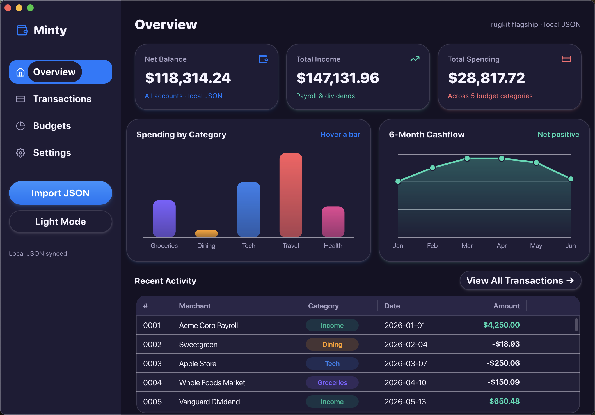

# rugkit

**Rugkit - The one framework that cares about visuals.**

rugkit is a Rust GUI framework built around visual polish and motion: a bold, playful design language, implicit spring animations, soft layered shadows, crisp system text and GPU-accelerated rendering out of the box.

> **Status: 0.1.0 (macOS only for now).** All v1 milestones (M0–M6) are complete on macOS, with a portable core ready for Windows and Linux. See [PLAN.md](PLAN.md) for decisions, scope and performance numbers.



> 🎬 Watch the recorded flagship walkthrough: [docs/demo/flagship.mp4](docs/demo/flagship.mp4)

## What works today
- **Windowing & multi-window:** GPU-rendered frame loop (`winit` + `wgpu`/Metal + `vello`), multi-window with shared signals (`run_windows`), transparent macOS titlebar with draggable regions, native macOS menu bars (`muda`), system clipboard (`arboard`), and on-demand redraws (idle windows draw nothing).
- **`Painter`:** rounded rectangles, circles, vector `Path`s (with SVG `d` parsing), strokes, linear gradients, layered soft shadows, rounded clipping, opacity layers, RGBA8 `ImageData`, and headless GPU `OffscreenRenderer`.
- **Typography:** system fonts shaped by `parley` — SF Pro Rounded for UI text and SF Pro for dense content (never bundled), with variable weights and layout caching.
- **Fine-grained signals:** `Copy` `signal`, `memo`, `effect`, `Tracker` and `Owner` with glitch-free push-pull propagation, batching, and automatic event-loop waking via `WakeHandle`.
- **Core widget set:** `text`, `button`, `text_input` (single-line & multiline with CJK IME + clipboard), `checkbox`, `toggle`, `slider`, `radio`, `select`, `tabs`, `scroll`, `virtual_list` (100k+ rows), `table` (100k+ virtualised rows, sticky header, sort, column resize, single & multi-row selection, custom cell renderers), `canvas` (reactive `Painter` with automatic signal tracking & `HitRegions`), `image`, `icon` (bundled Lucide icons behind default-on `icons` feature), `modal`, `popover`, `tooltip`, `row`, `column`, `grid`, `zstack`.
- **Theming, motion & RTL:** typed design tokens (`Theme`, `Radii`, `Spacing`, `TypeScale`) with reactive macOS Light/Dark + accent tracking, subtree overrides (`theme_scope`), RTL layout mirroring (`direction_scope`), and implicit interruptible springs respecting macOS Reduce Motion.
- **Async:** executor-agnostic `spawn(future)` and `resource(async { ... })` on a small built-in worker pool (no `tokio` dependency).
- **Dev tooling & testing:** `⌘⌥I` in-app inspector (layout bounds, slow-mo, live theme switching, frame stats), `cargo rugkit dev` hot-reload CLI (`subsecond` + `notify` watcher) keeping signal state across view patches, AccessKit/VoiceOver bridge, headless `Harness` test API, and non-blocking offscreen pixel snapshots.
- **Guide:** full mdBook guide in [book/](book/src/SUMMARY.md) (`mdbook serve book`).

## Try it

Requires macOS and Rust 1.98 or newer.

```bash
cargo run --release --example finance       # Flagship personal finance app
cargo run --release --example canvas_chart  # Animated Canvas charts + 100k-row Table
cargo run --release --example gallery       # Full widget gallery (Light & Dark)
cargo run --release --example todo          # Interactive Todo app
cargo run --release --example counter       # Counter with springs, IME, AccessKit & menus
```

```rust
use rugkit::prelude::*;

fn main() -> Result<(), rugkit::Error> {
    rugkit::launch(WindowOptions::default(), || {
        let count = signal(0);
        column((
            text(move || count.get().to_string()).size(64.0).weight(FontWeight::BLACK),
            button("Add one").on_click(move || count.update(|c| *c += 1)),
        ))
        .gap(16.0)
    })
}
```

## Contributing
Read [AGENTS.md](AGENTS.md) first. It covers workspace layout, commands and the rule that docs are updated in the same change as the code.

## License
Licensed under either of [Apache License, Version 2.0](LICENSE-APACHE) or [MIT license](LICENSE-MIT), at your option.
