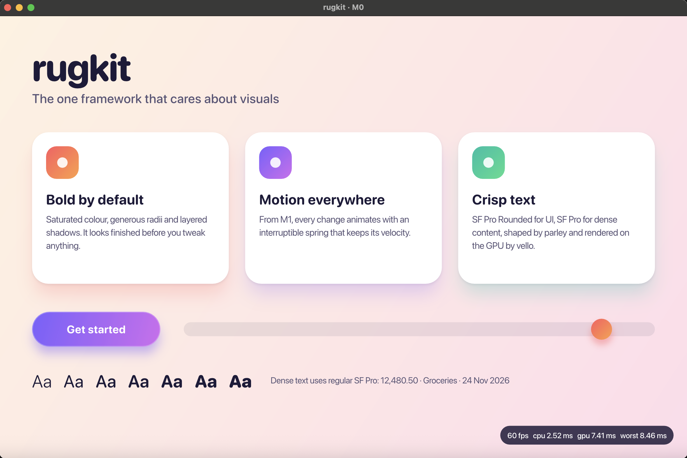

# rugkit

**Rugkit - The one framework that cares about visuals.**

rugkit is a Rust GUI framework built around visual polish and motion: a bold, playful design language, implicit spring animations, soft layered shadows and crisp text out of the box.

> **Status: early development, M0 (pixels on screen).** Nothing is published yet. v1 targets macOS first and keeps the core portable. See [PLAN.md](PLAN.md) for decisions, scope and milestones.



## What works today (M0)
- A window with a GPU-rendered frame loop (winit + wgpu/Metal + vello)
- `Painter`: rounded rectangles, circles, strokes, linear gradients, gaussian soft shadows
- Text shaped by parley: SF Pro Rounded for UI text and SF Pro for dense text, both loaded from macOS (never bundled), with variable font weights
- Live `FrameStats` (fps, CPU time, GPU time, worst frame)

## Try it

Requires macOS and Rust 1.98 or newer.

```bash
cargo run --release --example m0_pixels
```

```rust
use rugkit::prelude::*;

struct Hello;

impl App for Hello {
    fn draw(&mut self, p: &mut Painter<'_>, _frame: &FrameInfo) {
        let card = Rect::from_xywh(40.0, 40.0, 320.0, 160.0);
        p.shadow(card, 24.0, &Shadow::new(Color::BLACK.with_alpha(0.15), Vec2::new(0.0, 12.0), 32.0));
        p.fill_rect(card, 24.0, Color::WHITE);
        p.text("Hello, rugkit", Point::new(64.0, 64.0), &TextStyle::new(28.0).weight(FontWeight::BOLD));
    }
}

fn main() -> Result<(), rugkit::Error> {
    rugkit::run(WindowOptions::default(), Hello)
}
```

## Roadmap
M0 pixels → M1 signals, layout and springs → M2 platform integration (focus, IME, accessibility) → M3 widgets, theming, inspector → M4 Table and Canvas → M5 hot-reload → M6 flagship app and 0.1. Details are in [PLAN.md](PLAN.md).

## Contributing
Read [AGENTS.md](AGENTS.md) first. It covers workspace layout, commands and the rule that docs are updated in the same change as the code.

## License
Licensed under either of [Apache License, Version 2.0](LICENSE-APACHE) or [MIT license](LICENSE-MIT), at your option.
